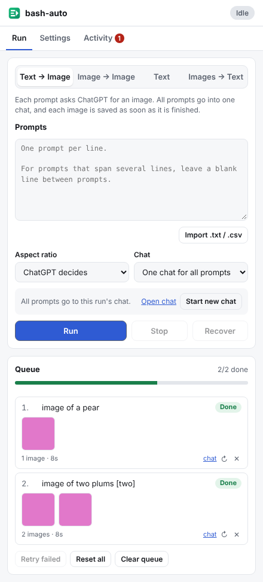

# bash-auto — ChatGPT image automation

A Chrome extension that sends a list of prompts to [chatgpt.com](https://chatgpt.com) one after another, waits until each image is really finished, and saves it to your Downloads folder.

<p align="center"></p>

## What it does

- **One chat for the whole run.** The first prompt opens a chat, and every later prompt goes into that same chat, including retries and recoveries. A new chat is only used if you ask for one:
  - choose "New chat for each prompt"
  - tag a prompt "new chat here"
  - press **Start new chat**
- **Knows when an image is finished.** It checks three independent sources and decides only from all of them:
  - ChatGPT's reply stream
  - ChatGPT's own conversation data
  - the page itself (finished images, the "Creating image" indicator, previews)

  It never marks an image as failed while any of them shows ChatGPT is still working.
- **Survives network drops.** When the connection goes, the run pauses on **Waiting for network**. No retries are used and nothing is skipped. When the connection is back, it reloads the chat. If the image finished meanwhile it's collected; if not, it's followed or sent again, never twice.
- **Keeps going without the panel.** The run lives in the extension's background worker, so you can close the panel. If Chrome restarts the worker, the run picks up where it was.
- **Four modes:** Text → Image (default), Image → Image (with your source images), Text, and Images → Text.
- **Saves everything:** images as `Downloads/<folder>/001-<prompt>.png` (`-2`, `-3`… when a reply has several images), text replies as `.md` or `.txt`.

## Install (developer mode)

1. Download or clone this repository.
2. Open `chrome://extensions` (or `edge://extensions`, `brave://extensions`…).
3. Turn on **Developer mode** (top right).
4. Click **Load unpacked** and select the repository folder (the one with `manifest.json`).
5. Pin the extension and click its icon: the panel opens on the side.
6. **After updating the code:** click the reload icon on the extension's card, then reload any open chatgpt.com tabs once.

Works in Chrome 116+ and other Chromium browsers (Edge, Brave, Opera, Vivaldi, Arc).

## Use

1. Log in to chatgpt.com in a tab.
2. Open the panel, keep **Text → Image**, and paste your prompts. Put one per line, or leave a blank line between prompts that span several lines. You can also **Import .txt / .csv**.
3. Optionally pick an aspect ratio.
4. Press **Run**. Watch the queue: *Sent → Generating image → Saving → Done*, with a thumbnail of each image.

| Button | What it does |
| :--- | :--- |
| **Stop** | Stops the queue. ChatGPT finishes what it's drawing; **Run** collects it later without resending. |
| **Recover** | Reloads the ChatGPT tab and picks the current prompt up again. Nothing is sent twice. |
| **Start new chat** | The next prompt opens a new chat, and the run continues in it. |
| **Retry failed** | Queues failed and refused prompts again. |

## Settings

| Setting | Default | Meaning |
| :--- | :--- | :--- |
| Prompts go to | One chat | Or a new chat for each prompt |
| First prompt of a run | New chat | Or the chat open in the ChatGPT tab |
| Model | — | Model id for new chats, as in `chatgpt.com/?model=…` |
| Images per prompt | 1 | Runs each prompt several times; files get `-v2`, `-v3`… |
| New prompts use | Their own images | Or "Last image": the previous generated image is sent with the prompt |
| Wait for an image up to | 30 min | Only applies while ChatGPT still shows it's working |
| No-image wait | 3 min | How long *nothing* must happen before "no image" (then it asks ChatGPT once to draw it) |
| Delay between prompts | 3–8 s | Random wait, to stay clear of rate limits |
| Retries per prompt | 3 | Network drops, reloads and restarts never count |
| Folder in Downloads | ChatGPT-Images | |

## How a prompt is followed

```
 panel ──commands──▶ service worker (engine) ──CGA_SUBMIT / CGA_POLL every 1.5 s──▶ content script (agent)
                          │  saves queue + run state                                   │ every poll gathers:
                          ▼                                                            ├─ stream  (page-hook.js: fetch + WebSocket)
                    chrome.storage ◀── panel re-renders on change                      ├─ data    (/backend-api/conversation/<id>)
                                                                                       └─ page    (dom.js)
                                                                                            ▼
                                                                                       decide.js → wait / done / nudge / error / network
```

- `content/decide.js` holds the rules, and `tests/unit/decide.test.js` checks them.
- Before any retry, the agent looks in the chat for the prompt (by its message id, then by its text after the previous prompt) and follows what it finds instead of sending it again.
- Each prompt only counts images that weren't in the chat before it was sent, so a long chat with hundreds of images never mixes them up.

## First run on the live site: quick check

The automated tests run against a fake chatgpt.com built to match the real one's requests and data. Before a long batch on the real site, run a short one:

1. Queue 3 image prompts and press **Run**.
2. In **Activity**, check that each prompt shows *sent → generating the image → done* and a `Saved …` line.
3. Open the chat link: all three prompts should be in one chat.
4. Mid-image, turn Wi-Fi off for a minute, then back on. The panel should show **Waiting for network**, then continue by itself.

If any step differs, use **Copy diagnostics** right away. The report shows what the stream, the conversation data and the page showed.

## Troubleshooting

| Problem | What to do |
| :--- | :--- |
| "Waiting for login" | Log in to chatgpt.com in the tab the extension uses. The run continues by itself. |
| "Waiting for network" for a long time | Check the connection. The run continues by itself once chatgpt.com loads again. |
| A prompt seems stuck | The **Activity** tab adds a *check* line every minute: what the reply stream, the conversation data and the page show. Press **Recover** to reload and pick it up. |
| Downloads ask where to save | Turn off "Ask where to save each file before downloading" in Chrome's settings. |
| Something else | **Activity → Copy diagnostics** and include the report in a bug report. |

## Development

```bash
npm test           # unit tests: decision rules, conversation reader, stream parser, engine (fake tab), helpers
npm run check      # manifest, files, syntax, panel ids
npm run test:e2e   # the real extension in Chromium against a fake chatgpt.com (tests/fake)
npm run package    # dist/bash-auto-<version>.zip
```

The e2e tests need Playwright with Chromium (or `CHROMIUM_PATH`). They cover:
- one chat for 15 image prompts
- slow, silent and preview-first images, two-image replies, a question answered with one follow-up
- network loss mid-image (offline, and "online" with no internet)
- starting offline, a tab reload, the panel closed mid-run
- an image task that dies with an error (resent in the same chat), and a page-only fallback when ChatGPT's data can't be read
- refusals, errors and retries, Stop/Run, Image → Image uploads, text replies
- a too-long chat, and one chat per prompt

```
manifest.json
background/   service-worker.js (entry, commands, watchdog) · engine.js (queue) · store.js · downloads.js
content/      page-hook.js + sse.js (page world) · agent.js · decide.js · conversation.js · dom.js
panel/        the side panel (index.html, panel.css, panel.js)
offscreen/    makes blob: URLs for downloads
lib/utils.js  shared helpers
tests/        unit/, e2e/, fake/ (fake chatgpt.com)
videos/       HyperFrames video projects (unrelated to the extension; see CLAUDE.md)
```

## Notes

- The panel is in English.
- Not affiliated with OpenAI. Automating chatgpt.com is subject to OpenAI's terms and your plan's limits. Keep reasonable delays.
